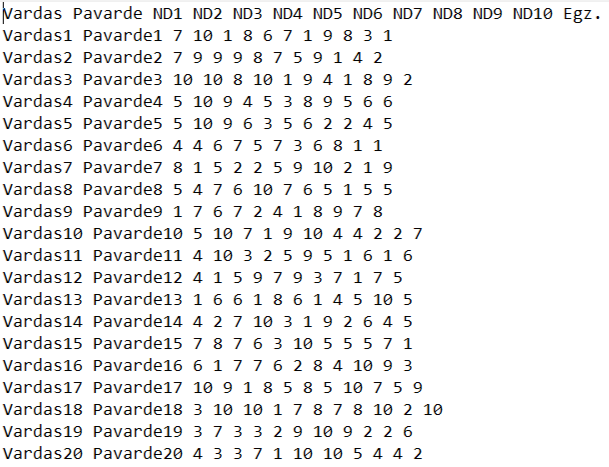
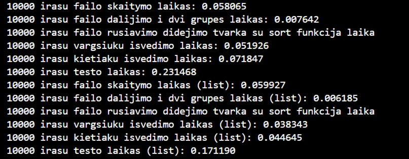

# 1-uzduotis

## Testavimo aplinka

* CPU: Intel Core i5-7200U
* RAM: 8 GB
* Diskas: 256 GB Micron 1100 SATA SSD

## Failu kurimas

Programa atsitiktinai generuoja penkis tekstinius studentu sarasu failus is atitinkamai 1000, 10000, 100000, 1000000 ir 10000000 irasu. Kiekviena ju sudaro vardo, pavardes stulpeliai ir atsitiktinai parinktas kiekis namu darbu pazymiu stulpeliu (nuo 7 iki 20 imtinai). Namu darbu ir egzamino pazymiai generuojami atsitiktinai nuo 1 iki 10 imtinai.

### Failu kurimo laikas:

|Failas|Laikas (s)|
|------|----------|
|1000 irasu (10 ND)|0.016536|
|10000 irasu (7 ND)|0.125006|
|100000 irasu (10 ND)|0.827061|
|1000000 irasu (19 ND)|12.645660|
|10000000 irasu (17 ND)|114.053876|
---

## Programos spartos analize

Spartos analizes testo vykdymo pavyzdys:

Zemiau pateikiami programos spartos analizes rezultatu ***vidurkiai*** Vector ir List atvejais, apskaiciuoti atlikus tris testus:

### Programos sparta (Vector):

|Failas|Nuskaitymas, s|Studentu dalijimas, s|Rusiavimas didejimo tvarka su sort, s|Vargsiuku isvedimas, s|Kietiaku isvedimas, s|Is viso, s|
|------|--------------|---------------------|-------------------------------------|----------------------|---------------------|----------|
|1000 irasu (10 ND)|0.006688|0.0012397|0.002567|0.0040737|0.011083|0.025651|
|10000 irasu (7 ND)|0.056445|0.010307|0.041292|0.056131|0.039894|0.204068|
|100000 irasu (10 ND)|0.440908|0.099296|0.418183|0.348743|0.459762|1.766892|
|1000000 irasu (19 ND)|6.887332|0.793486|4.529689|3.080861|3.925973|19.217341|
|10000000 irasu (17 ND)|52.865884|8.911304|56.613534|32.336232|43.816994|194.543947|
---
**Isvada:** Siuo atveju sparciausiai vykdoma studentu dalijimo funkcija, o kitu funkciju spartos tendencijas sunkiau izvelgti nei List konteinerio atveju.

### Programos sparta (List):

|Failas|Nuskaitymas, s|Studentu dalijimas, s|Rusiavimas didejimo tvarka su sort, s|Vargsiuku isvedimas, s|Kietiaku isvedimas, s|Is viso, s|
|------|--------------|---------------------|-------------------------------------|----------------------|---------------------|----------|
|1000 irasu (10 ND)|0.009657|0.000831|0.000864|0.005196|0.004801|0.021349|
|10000 irasu (7 ND)|0.060239|0.006945|0.007101|0.043280|0.042421|0.159986|
|100000 irasu (10 ND)|0.682869|0.074323|0.125628|0.394981|0.454135|1.731935|
|1000000 irasu (19 ND)|8.367813|0.624856|1.328955|3.657743|4.594591|18.573957|
|10000000 irasu (17 ND)|62.052814|6.931588|17.658217|33.601936|42.680251|162.924806|
---
**Isvada:** Siuo atveju sparciausiai vykdomas studentu dalijimas, o leciausiai - nuskaitymas. Skirtumas tarp funkciju vykdymo spartos List konteinerio atveju yra labiau pastebimas nei Vector tipo.