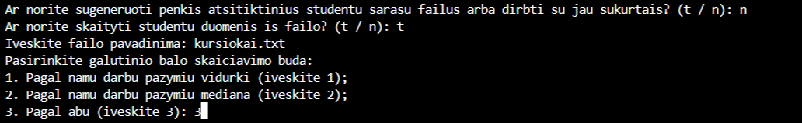
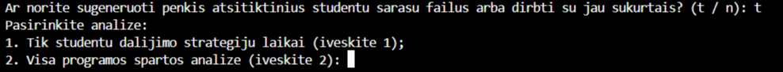
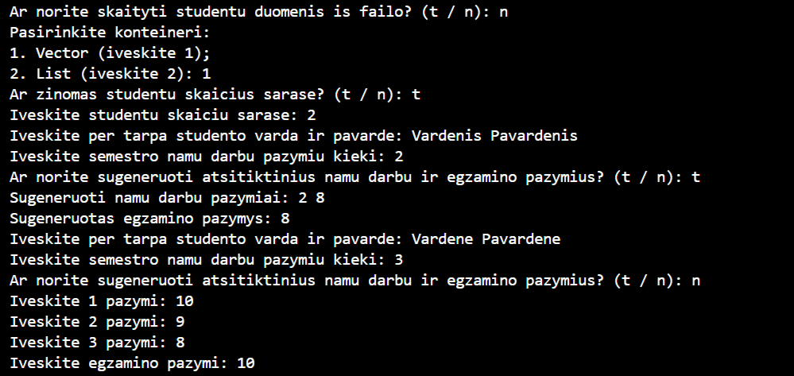
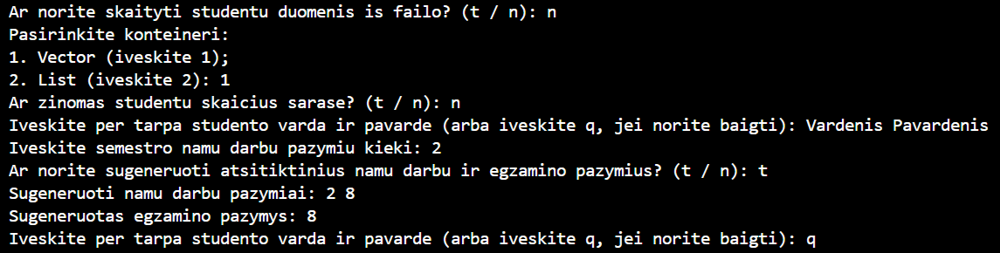
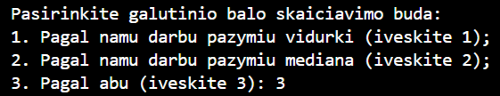
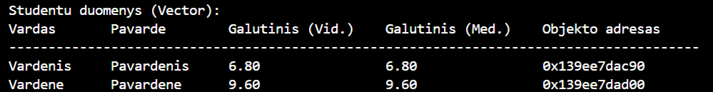
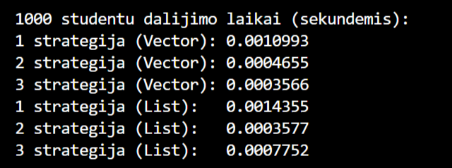

# 1-uzduotis

## Releases

* **v0.1:** Sudaro pagrindine programa *pradinis.cpp*, testinis studentu failas nuskaitymui *kursiokai.txt*, laikinai tuscias *README.md* failas tolimesnei dokumentacijai ir failas papildomu failu ignoravimui *.gitignore*.

* **v0.2:** Sudaro ankstesnio release failai (pradetas pildyti *README.md* ir pratestas *pradinis.cpp*) ir nauji antrastiniai failai *funkcijos.h* ir *studentas.h* bei funkciju implementacijos failas *funkcijos.cpp*.

* **v0.3:** Sudaro ankstesnio release failai (papildyti *README.md*, *pradinis.cpp*, *funkcijos.cpp* ir *funkcijos.h*) ir naujas nuotrauku albumas *nuotraukos*, naudojamas programos rezultatu dokumentacijai.

* **v1.0:** Sudaro ankstesnio release failai (papildyti *README.md*, *pradinis.cpp*, *funkcijos.cpp*, *funkcijos.h* ir albumas *nuotraukos*).

## Naudojimosi instrukcija

Programa veikia naudotojui pateikiant trumpus atsakymus i pateiktas uzklausas, t.y. tam tikrais atvejais tai gali buti ivedama raide "t" ("taip") arba "n" ("ne"), norimo skaityti failo pavadinimas, studento vardas ir pavarde arba skaicius, atitinkantis norimo pasirinkimo kategorija.

Programos vykdymo pavyzdys:



Programos pradzioje pasirinkus generuoti atsitiktinius failus arba dirbti su jau sukurtais, toliau galima rinktis is dvieju spartos testu: studentu dalijimo strategiju ir bendros programos spartos analizes (jei failu dar nera, jie bus sugeneruoti ir bus nurodyti ju kurimo laikai):



Kitu atveju, neskaitant duomenu is failo, naudotojui leidziama pasirinkti viena is dvieju studentu duomenu konteineriu (Vector arba List) ir nurodyti studentu skaiciu sarase (jei zinomas; priesingu atveju naudotojas gali ivesti kiek nori daug studentu duomenu, iki ives raide "q"). Veliau galima pasirinkti arba sugeneruoti studentu pazymius, arba ivesti juos ranka:

Programos vykdymo pavyzdys su zinomu studentu skaiciumi:



Programos vykdymo pavyzdys su nezinomu studentu skaiciumi:



Galiausiai naudotojui leidziama pasirinkti viena is triju galutinio balo skaiciavimo budu (pagal vidurki, mediana arba abu):



Rezultatas: pateikiami studentu duomenys ir kiekvieno is ju, kaip objekto, adresas atmintyje:




### Kompiliavimas ir paleidimas su CMake

Reikalingi irankiai: CMake 3.13 arba naujesne versija ir C++11 palaikantis kompiliatorius (pvz. GCC, Clang arba MSVC).
Noredami sukonfiguruoti ir sukompiliuoti programa, projekto root direktorijos terminale ivykdykite sias komandas:

```
cmake -S . -B build
cmake --build build --config Release
```

Vykdomojo failo vieta priklauso nuo CMake generatoriaus. Priklausomai nuo jo, projekto root direktorijoje iveskite:

* **MinGW Makefiles generatoriui:** build/studentu_programa.exe

* **Visual Studio generatoriui:** build/Release/studentu_programa.exe 

## Testavimo aplinka

* CPU: Intel Core i5-7200U
* RAM: 8 GB
* Diskas: 256 GB Micron 1100 SATA SSD

## Failu kurimas

Programa atsitiktinai generuoja penkis tekstinius studentu sarasu failus is atitinkamai 1000, 10000, 100000, 1000000 ir 10000000 irasu. Kiekviena ju sudaro vardo, pavardes stulpeliai ir atsitiktinai parinktas kiekis namu darbu pazymiu stulpeliu (nuo 7 iki 20 imtinai). Namu darbu ir egzamino pazymiai generuojami atsitiktinai nuo 1 iki 10 imtinai.

Studentu saraso failo pavyzdys:


### Failu kurimo laikas:

|Failas|Laikas (s)|
|------|----------|
|1000 irasu (10 ND)|0.016536|
|10000 irasu (7 ND)|0.125006|
|100000 irasu (10 ND)|0.827061|
|1000000 irasu (19 ND)|12.645660|
|10000000 irasu (17 ND)|114.053876|
---

## Programos spartos analize

Spartos analizes testo vykdymo pavyzdys:


Zemiau pateikiami programos spartos analizes rezultatu ***vidurkiai*** Vector ir List atvejais, apskaiciuoti atlikus tris testus:

### Programos sparta (Vector):

|Failas|Nuskaitymas, s|Studentu dalijimas, s|Rusiavimas didejimo tvarka su sort, s|Vargsiuku isvedimas, s|Kietiaku isvedimas, s|Is viso, s|
|------|--------------|---------------------|-------------------------------------|----------------------|---------------------|----------|
|1000 irasu (10 ND)|0.006688|0.0012397|0.002567|0.0040737|0.011083|0.025651|
|10000 irasu (7 ND)|0.056445|0.010307|0.041292|0.056131|0.039894|0.204068|
|100000 irasu (10 ND)|0.440908|0.099296|0.418183|0.348743|0.459762|1.766892|
|1000000 irasu (19 ND)|6.887332|0.793486|4.529689|3.080861|3.925973|19.217341|
|10000000 irasu (17 ND)|52.865884|8.911304|56.613534|32.336232|43.816994|194.543947|
---
**Isvada:** Siuo atveju sparciausiai vykdoma studentu dalijimo funkcija, o kitu funkciju spartos tendencijas sunkiau izvelgti nei List konteinerio atveju.

### Programos sparta (List):

|Failas|Nuskaitymas, s|Studentu dalijimas, s|Rusiavimas didejimo tvarka su sort, s|Vargsiuku isvedimas, s|Kietiaku isvedimas, s|Is viso, s|
|------|--------------|---------------------|-------------------------------------|----------------------|---------------------|----------|
|1000 irasu (10 ND)|0.009657|0.000831|0.000864|0.005196|0.004801|0.021349|
|10000 irasu (7 ND)|0.060239|0.006945|0.007101|0.043280|0.042421|0.159986|
|100000 irasu (10 ND)|0.682869|0.074323|0.125628|0.394981|0.454135|1.731935|
|1000000 irasu (19 ND)|8.367813|0.624856|1.328955|3.657743|4.594591|18.573957|
|10000000 irasu (17 ND)|62.052814|6.931588|17.658217|33.601936|42.680251|162.924806|
---
**Isvada:** Siuo atveju sparciausiai vykdomas studentu dalijimas, o leciausiai - nuskaitymas. Skirtumas tarp funkciju vykdymo spartos List konteinerio atveju yra labiau pastebimas nei Vector tipo, be to, bendras operaciju vykdymo laikas yra trumpesnis nei Vector atveju.

## 3 studentu dalijimo strategiju spartos analize

Naudotojas taip pat gali pasirinkti vykdyti tik studentu dalijimo funkcijos spartos analize pagal 3 strategijas:

1. Bendro studentu konteinerio (Vector ir List) skaidymas i du naujus to paties tipo konteinerius: "vargsiuku" ir "kietiaku";

2. Bendro studentu konteinerio (Vector ir List) skaidymas panaudojant tik viena nauja konteineri: "vargsiukai";

3. Bendro studentu konteinerio (Vector ir List) skaidymas panaudojant greiciau veikiancia 2 strategija, itraukiant i ja efektyvu Partition metoda.

Studentu dalijimo strategiju spartos analizes vykdymo pavyzdys:



Zemiau pateikiami 3 studentu dalijimo strategiju spartos analizes rezultatu ***vidurkiai*** Vector ir List atvejais, apskaiciuoti atlikus tris testus:

### 3 studentu dalijimo strategiju sparta (Vector):

|Failas|1 strategija, s|2 strategija, s|3 strategija, s|
|------|---------------|---------------|---------------|
|1000 irasu (10 ND)|0.000811|0.000495|0.000355|
|10000 irasu (7 ND)|0.008551|0.005814|0.003515|
|100000 irasu (10 ND)|0.060238|0.051621|0.034660|
|1000000 irasu (19 ND)|0.703370|0.497072|0.379706|
|10000000 irasu (17 ND)|7.443739|5.724879|3.906062|
---
**Isvada:** Siuo atveju leciausia yra 1 strategija, 2 strategija yra spartesne uz 1 strategija, o 3 strategija (2 strategija su Partition metodu) yra sparciausia.

### 3 studentu dalijimo strategiju sparta (List):

|Failas|1 strategija, s|2 strategija, s|3 strategija, s|
|------|---------------|---------------|---------------|
|1000 irasu (10 ND)|0.000874|0.000348|0.001098|
|10000 irasu (7 ND)|0.004945|0.003822|0.005035|
|100000 irasu (10 ND)|0.052069|0.041634|0.054542|
|1000000 irasu (19 ND)|0.558411|0.427090|0.576835|
|10000000 irasu (17 ND)|6.355367|4.551922|5.734487|
---
**Isvada:** Siuo atveju dominuojancias tendencijas izvelgti sunkiau, taciau beveik visu testu (isskyrus didziausio failo) metu leciausia yra 3 strategija, t.y. 2 strategija su Partition metodu (priesingai nei Vector atveju), o sparciausia - 2 strategija.